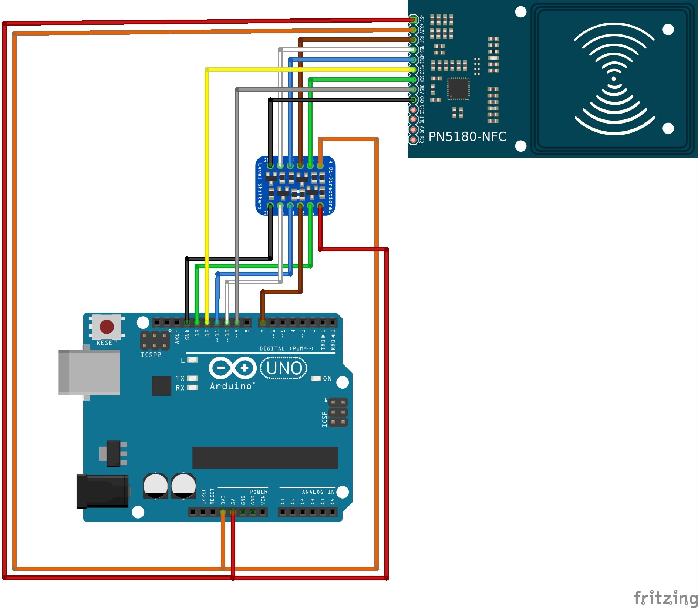

# Wiring

> **The PN5180 uses 3.3 V logic.** On 5 V boards (Arduino Uno, Nano, Mega) put a level shifter on every signal going *into* the PN5180 (SCK, MOSI, NSS, RST). ESP32 boards run at 3.3 V and connect directly.



## Signals

| PN5180 pin | Direction | Purpose |
|------------|-----------|---------|
| 5V | power | Supply for the RF transmitter on most modules |
| 3.3V | power | Logic supply |
| GND | power | Ground |
| SCK, MISO, MOSI | SPI | Connect to the SPI bus you use |
| NSS | into PN5180 | SPI chip select (active low); any free GPIO |
| BUSY | out of PN5180 | Handshake line the library polls before and after every command; any free GPIO |
| RST | into PN5180 | Hardware reset (active low); any free GPIO |
| IRQ | out of PN5180 | Interrupt line; only needed for Low Power Card Detection (LPCD) |

NSS, BUSY and RST are passed to the constructor. SCK, MISO and MOSI are the SPI bus pins. On ESP32 you can pick custom SPI pins with `begin(sck, miso, mosi)`. On Arduino Mega the hardware SPI pins are 50–52.

## Default pins in the examples

| PN5180 | Arduino Uno / Nano | ESP32 |
|--------|--------------------|-------|
| 5V | 5V | 5V (VIN) |
| 3.3V | 3.3V | 3.3V |
| GND | GND | GND |
| SCK | 13 (via level shifter) | 18 |
| MISO | 12 | 19 |
| MOSI | 11 (via level shifter) | 23 |
| NSS | 10 (via level shifter) | 16 |
| BUSY | 9 | 5 |
| RST | 7 (via level shifter) | 17 |

The LPCD examples use other pins and an IRQ line. See the `#define`s at the top of each sketch.

## Using another SPI bus (ESP32)

```cpp
SPIClass hspi(HSPI);
PN5180ISO14443 nfc(PN5180_NSS, PN5180_BUSY, PN5180_RST, hspi);

void setup() {
  nfc.begin(14, 12, 13);   // SCK, MISO, MOSI
}
```

The default SPI clock is 7 MHz. With long wires, lower it with `setSPISettingsFrecuency()` (see [Troubleshooting](troubleshooting.md)).
